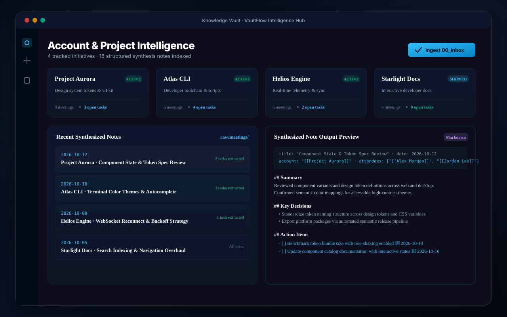

# VaultFlow

Structured note intake, meeting summaries, and account tracking for Obsidian.

[](https://obsidian.md)
[](https://opensource.org/licenses/MIT)

VaultFlow organizes meeting notes and transcripts in your vault. It reads incoming notes, drafts summaries and action items, and connects attendees and accounts using your preferred language model.



---

## Features

- **Inbox Processing**: Put raw notes or transcripts into `00_Inbox` and process them into `raw/meetings/` with one click.
- **Structured Notes**:
  - Concise summaries
  - Attendees linked as `[[WikiLinks]]`
  - Key decisions and discussion points
  - Action items formatted as `- [ ]` tasks
- **Model Choice**:
  - **Google Gemini** (1.5 Flash, 1.5 Pro, 2.0)
  - **Anthropic Claude** (3.5 Sonnet, 3.5 Haiku, 3 Opus)
  - **OpenAI** (GPT-4o, GPT-4o-mini, o1-mini)
  - **Ollama** (Local models: Llama 3, Mistral, Qwen)
- **Account Overview**: Displays account notes, meeting history, and open tasks in a single view.
- **Theme Support**: Matches light and dark themes using Obsidian's standard CSS variables.

---

## Installation

### Community Plugins
1. Open **Settings** → **Community plugins**.
2. Turn off **Restricted mode**.
3. Search for **VaultFlow**.
4. Select **Install**, then **Enable**.

### Manual Installation
1. Download `manifest.json`, `main.js`, and `styles.css` from the latest [Release](https://github.com/Rbm3267/obsidian-flow/releases).
2. Move them into `<vault>/.obsidian/plugins/vaultflow/`.
3. Reload Obsidian and turn on **VaultFlow** in **Community plugins**.

---

## Configuration

In **Settings** → **VaultFlow**:
- Choose your AI provider.
- Enter your API key or local Ollama address.
- Adjust folder paths (`00_Inbox`, `raw/meetings`, `Accounts`).

---

## Development

```bash
git clone https://github.com/Rbm3267/obsidian-flow.git
cd obsidian-flow
npm install
npm run dev    # watch build
npm run build  # production build
```

---

## License

MIT License © 2026 [XD Labs](https://xdlabs.io) / Bennett Moore.
